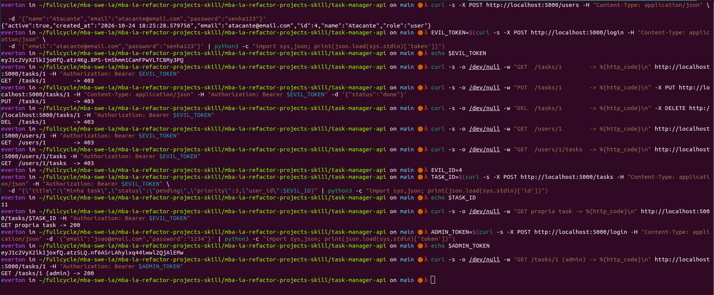

# Validação manual — correção de autorização por dono do recurso (AP-08, task-manager-api)

Passos para confirmar manualmente que a correção descrita em ["Correção pós-entrega"](audit-project-3.md) do `task-manager-api` está presente e funcionando: um usuário autenticado comum não consegue mais ler, alterar ou apagar dados de outro usuário.

Commit onde a correção foi introduzida: `0ce46e1` — "fix: enforce resource-owner authorization in task-manager-api".

## 1. Confirmar que o código corrigido está no repositório

```bash
cd task-manager-api
grep -n "ensure_self_or_admin" controllers/task_controller.py controllers/user_controller.py
```

Deve aparecer em `get_task`, `update_task`, `delete_task` (`task_controller.py`) e em `get_user`, `list_user_tasks` (`user_controller.py`).

## 2. Suba a aplicação via Docker

```bash
docker compose up --build -d
docker compose logs -f api   # Ctrl+C depois de ver "Seed concluído" e o servidor no ar
```

## 3. Reproduza o ataque — cadastro público seguido de acesso a dado de terceiro

```bash
# Cadastro público
curl -s -X POST http://localhost:5000/users -H "Content-Type: application/json" \
  -d '{"name":"Atacante","email":"atacante@email.com","password":"senha123"}'

# Login com o usuário recém-criado
EVIL_TOKEN=$(curl -s -X POST http://localhost:5000/login -H "Content-Type: application/json" \
  -d '{"email":"atacante@email.com","password":"senha123"}' | python3 -c "import sys,json; print(json.load(sys.stdin)['token'])")

# Tentativas contra dado de OUTRO usuário (id 1, o admin do seed) — esperado 403 em todas
curl -s -o /dev/null -w "GET  /tasks/1        -> %{http_code}\n" http://localhost:5000/tasks/1 -H "Authorization: Bearer $EVIL_TOKEN"
curl -s -o /dev/null -w "PUT  /tasks/1        -> %{http_code}\n" -X PUT http://localhost:5000/tasks/1 -H "Content-Type: application/json" -H "Authorization: Bearer $EVIL_TOKEN" -d '{"status":"done"}'
curl -s -o /dev/null -w "DEL  /tasks/1        -> %{http_code}\n" -X DELETE http://localhost:5000/tasks/1 -H "Authorization: Bearer $EVIL_TOKEN"
curl -s -o /dev/null -w "GET  /users/1        -> %{http_code}\n" http://localhost:5000/users/1 -H "Authorization: Bearer $EVIL_TOKEN"
curl -s -o /dev/null -w "GET  /users/1/tasks  -> %{http_code}\n" http://localhost:5000/users/1/tasks -H "Authorization: Bearer $EVIL_TOKEN"
```

Resultado esperado: as 5 linhas mostram `-> 403`. Se alguma vier `200`, a correção não está no código que está rodando.

## 4. Confirme que dono legítimo e admin continuam funcionando

```bash
# Atacante cria e acessa a própria task — esperado 200
EVIL_ID=4   # ajuste se o id retornado no passo 3 for diferente
TASK_ID=$(curl -s -X POST http://localhost:5000/tasks -H "Content-Type: application/json" -H "Authorization: Bearer $EVIL_TOKEN" \
  -d "{\"title\":\"Minha task\",\"status\":\"pending\",\"priority\":3,\"user_id\":$EVIL_ID}" | python3 -c "import sys,json; print(json.load(sys.stdin)['id'])")
curl -s -o /dev/null -w "GET propria task -> %{http_code}\n" http://localhost:5000/tasks/$TASK_ID -H "Authorization: Bearer $EVIL_TOKEN"

# Admin acessa dado de qualquer usuário — esperado 200
ADMIN_TOKEN=$(curl -s -X POST http://localhost:5000/login -H "Content-Type: application/json" -d '{"email":"joao@email.com","password":"1234"}' | python3 -c "import sys,json; print(json.load(sys.stdin)['token'])")
curl -s -o /dev/null -w "GET /tasks/1 (admin) -> %{http_code}\n" http://localhost:5000/tasks/1 -H "Authorization: Bearer $ADMIN_TOKEN"
```

Resultado esperado: as 2 linhas mostram `-> 200`.

## 5. Derrube o container

```bash
docker compose down
```

## Resultado

Validado manualmente em 2026-10-24: todos os passos acima se comportaram conforme o esperado (passos 3 e 4).

